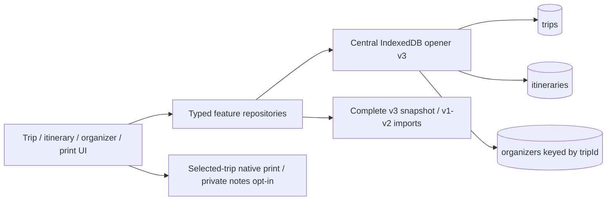
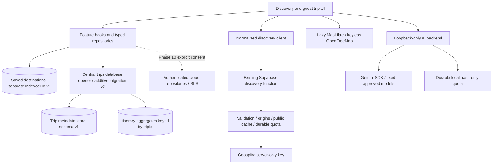

# Phase 9 review boundary — 11 November 2026

Keep existing feature-oriented React/Vite/strict TypeScript, centralized IndexedDB v4, trip-owned aggregates and complete compatible backup v4. Phase 9 adds regression/network-isolation/performance evidence and only narrowly reproduced local fixes. No schema/store/migration, provider model/configuration, hosted function or dependency change is planned. Existing server/client security boundaries remain. See [Phase 9 implementation](PHASE_9_IMPLEMENTATION.md) for final changes.

## Accepted Phase 8 architecture — preserved

# Current Phase 8 architecture — 11 November 2026

Central `smart-travel-trips` IndexedDB **v4** adds only `budgets`, keyed by tripId; existing trips/itineraries/organizers and separate saved destinations are retained. Budget schema v1 stores bounded assumptions, original trip basis, custom estimates, manual reference ratios and actual expenses with frozen conversions. Budget writes atomically check budget+trip revisions and touch the trip. Snapshots/imports/deletion cover four stores. UI never opens IndexedDB. Valid v1/v2/v3 inputs remain compatible; complete v4 exports/imports include all aggregates with previews, fingerprints and ID-remapped conflict copies.

`features/budget` owns pure exact calculations, currency provenance, typed repository and focused UI. `features/weather` owns a validated keyless client, temporary session cache and explicit-action panel. Weather sends only existing verified coordinates, with cancellation, ten-second timeout, no retries, 64 KiB body bound, strict date/array/unit validation and labeled one-hour cache freshness. It does not use the hosted discovery/AI functions. Budgets can consume matching recent route data from the existing local query cache without a provider request.

Route `/trips/:tripId/budget` integrates overview/itinerary/organizer. Print receives one consistent selected-trip snapshot, with estimates/actual totals separately opt-in and private notes off. Static reference rates are bundled, not fetched at runtime; expense ratios/dates stay frozen. No dependency/auth/cloud/backend changes. See [implementation and data boundaries](PHASE_8_IMPLEMENTATION.md). Older architecture below is retained as dated history; DB4/backup4 supersede older current-version descriptions.

## Prior architecture — retained

# Current Phase 7 architecture — 11 November 2026

This current addendum supersedes older DB v2/backup v2 descriptions below. `src/features/organizer/` owns strict domain contracts, six local templates, typed OrganizerRepository, focused editor/list components and lazy organizer/print pages. Existing discovery/AI/server and hosted resources remain unchanged. No new dependency or provider.

The only upgrade is additive smart-travel-trips v3 creating organizers; existing v1/v2 records and the separate saved-destination database are untouched. Missing organizers derive empty schema-v1 records until first save. Organizer writes atomically check trip and organizer revisions and touch the trip, invalidating stale approvals without changing AI logic. Trip deletion/import operate across all three stores; snapshots read them consistently. Existing metadata/date edits preserve organizer content. UI never opens IndexedDB.

V3 backups contain one validated itinerary and organizer per trip. Legacy imports derive missing empty aggregates. Organizer content participates in duplicate fingerprints; conflicting copies remap ownership/child IDs without overwriting existing data. The 10 MB and 200-trip limits remain. Print reads only the selected trip and excludes organizer/day/activity/item notes by default. No attachments or cloud upload. [Implementation detail](PHASE_7_IMPLEMENTATION.md).

## Prior architecture descriptions — dated history

# Application architecture

Updated 7 November 2026. Phases 0–5 complete; Phase 6 and the local Phase 6.1 destination-search correction are authorized. Guest-first/local-first remains approved; authentication, personal cloud data and collaboration wait until final Phase 10. Existing frontend stack and repository boundaries remain unchanged.

Phase 6.1 extends the existing discovery contract to documented locality/city/state/country requests. Normalization preserves country/state/county/district/settlement identity, optional geographic context and provider IDs/coordinates; POI searches remain separate. Destination caches use `destinations-v2`, leaving nearby/mapping namespaces intact. Guest destination references gain optional type/context only; centralized database opening, DB/record/backup versions and atomic repositories are unchanged. Name suggestions contain sourced names only and require explicit action. The UI identifies administrative coordinates as reference points, not boundaries. See [compatibility review](PHASE_6_1_REVIEW.md). The updated discovery source is prepared locally; no hosted deployment or AI change is included.

## Current boundaries

There is no personal cloud database, invented user or automatic trip upload. Phase 6 adds controlled local AI; no hosted AI endpoint is deployed. Phase 5 adds an optional map and local secure location/routing extensions without hosted mutation. The cache holds bounded provider geocoding/road responses without trip IDs, traveler identity, activity titles or notes. Ordered coordinates are sent only after explicit route confirmation and are part of the cached public road response; whole trip records are never uploaded.

## Centralized local database and aggregate

Features own domain schemas, components, pages and repository adapters. UI never opens IndexedDB. TripRepository and ItineraryRepository share `src/features/trips/services/trips-database.ts`: smart-travel-trips version 2, one additive migration creating itineraries keyed by tripId. Existing v1 trips are not rewritten, deleted or reset; their schemaVersion stays 1. Opening a new database creates both stores. Separate smart-travel-discovery version 1 and saved-destination records remain untouched. Every handle closes on versionchange and after use. Blocked upgrades report close-older-tabs guidance; abandoned pending upgrades abort; unsupported future versions fail without downgrade/reset.

Trip IDs and activity IDs are UUIDs. Trips retain schema/revision/timestamps, title, destination provenance/optional paired coordinates, calendar range, travelers/group, integer minor-unit budget/currency, interests, pace and status. Calendar arithmetic validates real Gregorian dates (1900–2199), inclusive 1–366 days, without timezone conversion. Dashboard grouping uses the local current date.

One validated itinerary aggregate holds schemaVersion 1, tripId, optimistic revision and an ordered array of day records. Dates must exactly match the parent trip's inclusive range. Each day holds a bounded note and ordered activities. Activity IDs must be unique, dates must match their owning day, and no edit may address another trip's activity. A legacy trip without a stored aggregate receives derived empty days on read; the first write persists them. No sample activity is silently inserted.

Activities include title/description, optional HH:mm destination-local wall-clock start, 1–1440 minute duration, one of ten categories, optional location name/paired bounded coordinates, optional estimated integer minor-unit cost and currency, and notes. There is no venue-hours, transit-time or timezone validation. Overlap/past-midnight/order reminders do not change data. New or retimed activities sort stably by start time; unscheduled activities follow scheduled entries. Explicit up/down order is persistent. Editing other fields preserves a manually chosen order. Sort by time is explicit.

## Transactional integrity and dates

Itinerary mutations read both stores in a single readwrite transaction, compare the expected itinerary revision, validate the result, increment the itinerary revision and the trip revision/update timestamp, then commit both. A metadata editor opened before an itinerary change cannot overwrite it. Activity editing may safely coexist with metadata-only changes because it reads current metadata inside its transaction. Success is reported only after transaction completion. Storage errors preserve existing data and entered form drafts; no in-memory success fallback exists.

Date edits read a current snapshot before showing keep-calendar-dates versus shift-by-day-number previews. The preview lists affected content, retained/removed activity counts and removed note days. Dropping content requires an explicit discard checkbox. The commit checks the original trip revision again and performs reconciliation and metadata writes atomically. Extending an empty trip needs no loss dialog. Empty removed days contain no personal content. Deleting a trip checks its revision and deletes both its metadata and aggregate in the same transaction after user confirmation. No orphan itinerary survives.

## Routes

| Route                                              | Behavior                                                                         |
| -------------------------------------------------- | -------------------------------------------------------------------------------- |
| /, /discover, /destinations/:destinationId, /saved | Existing curated/provider discovery and separate device saves                    |
| /trips, /trips/new                                 | Guest dashboard and seven-step creation wizard                                   |
| /trips/:tripId                                     | Overview, itinerary entry, edit and confirmed cascading delete                   |
| /trips/:tripId/edit                                | Wizard with revision checks and safe date preview                                |
| /trips/:tripId/itinerary                           | Local days, timeline, activity CRUD/reorder, day notes, complete per-trip export |
| /settings, /design-system                          | Existing configuration/capability and design-system views                        |

Organizer (7), budget tools (8) and authentication/collaboration (10) have no current routes/modules. AI (6) is integrated into the existing itinerary route, without a new route or login. A missing local trip reports missing data and recovery guidance, never a substituted demo/cloud trip.

## Complete backup and recovery

TripRepository.exportSnapshot reads metadata and plans in one readonly snapshot. All product exports use version 2 of the strict smart-travel-trips envelope, including the entire itinerary with notes, order, coordinates and estimates. The legacy exportTrips metadata-only helper remains available for v1 compatibility tests; product UI always passes complete aggregates. Valid v1 files normalize into empty itineraries. Bounded limits: 10 MB UTF-8, 200 trips, 366 days/trip, 200 activities/trip, 100/day, 2000 characters/day note, bounded activity text. Reject whole files on invalid/unknown fields, IDs, dates, relationships or bounds before preview/write. Large workspaces can use per-trip complete exports; never silently truncate.

Import preview and explicit confirmation show counts/names/version/activity count. Fingerprints compare validated trip content plus the complete ordered itinerary while excluding identity/revision/timestamps. Identical aggregates skip; divergent IDs copy under fresh trip and activity IDs. Shared activity IDs from otherwise new imports are also remapped. Originals never overwrite. Repeated conflict copies deduplicate semantically. Commit re-reads both stores, rechecks duplicates/capacity and atomically adds all new trips and plans. No partial import or arbitrary IndexedDB dump is accepted. Backups are unencrypted personal files and never review inputs.

Phase 10 remains documentation only: after sign-in ask explicit consent, preview selected local data, map IDs and relationships, compare versions/content, retain originals, use idempotent transactional imports and receipts, and provide recoverable errors. Sign-in/out never deletes or uploads local data automatically. Cloud repositories/RLS/owner-editor-viewer roles are not implemented early.

## Security, configuration and verification

### Integration sequencing decision

The reviewed Phase 2/5 discovery backend remains deployed and unchanged in Phase 6; historical mapping architecture is described below. Phases 3–4 add only guest records in the browser. No new environment values, OAuth, SQL or hosted operation is required. Setup projects only allowlisted public values; confidential provider/admin/deployment values never enter frontend builds. The existing .env remains byte-for-byte preserved.

Local IndexedDB is accessible to same-origin JavaScript/browser profile, may be evicted/cleared and is neither encryption, account isolation nor cloud backup. Render all user/provider text as text; no HTML injection. Manual planning edits work offline after app assets are loaded; no service-worker/cold-start offline guarantee is introduced. Save errors and stale edits are visible; unsaved drafts are transient. Refresh/close warnings depend on browser support; day navigation protects note drafts. No private documents are collected.

Tests distinguish fake-indexeddb/RTL persistence tests, actual browser IndexedDB and offline editing, mocked provider regression responses, and preserved historical Phase 2 live evidence. Responsive axe/keyboard/overflow checks target 360/768/1024/1440 px; they are not a full accessibility audit. Build and review ZIP scan known/configured credentials with explicit limits. Future provider terms must be rechecked in their owning phase; anonymous AI must stay controlled if abuse cannot be bounded. No frontend publication is authorized.

## Phase 5 mapping architecture — 5 November 2026

The mapping feature owns typed Coordinates/MapLocation/MapMarker/TravelMode/RouteGeometry/MapRoute contracts, provider transport and normalization, location search, route controls, map controller and lazy canvas. Named latitude/longitude coordinates convert only at boundaries: Geoapify route waypoints use lat,lon; GeoJSON/MapLibre use lon,lat. Selection belongs to the itinerary workspace and is scoped by day/stable activity ID; it never rewrites activity order. Marker clicks focus/highlight the corresponding card; mobile returns to the itinerary. Cards/location-list controls select markers or open explicit location editing.

MapPanel renders a useful location/route alternative before tiles load. MapCanvas dynamically imports MapLibre 6.16.0/CSS and the Vite worker URL via ?worker&url; one instance survives marker/day/selection updates. MapController updates existing keyed marker buttons, validates positions, draws only provider geometry, fits route/marker bounds (including antimeridian wrapping), respects reduced motion and removes listeners/markers/instance. ResizeObserver handles hidden/mobile views; cleanup disconnects observer/RAF/worker-backed map. A local error boundary isolates lazy-module failures; WebGL/style/tile failure leaves manual editing and the accessible location list intact. OpenFreeMap is fixed to the keyless Positron style; attribution remains visible.

LocationSearch uses shared curated centre coordinates for offline/demo and a debounced/cancelled bounded secure geocode search for real places. Explicit preview/use plus activity Save protects existing manual locations. Only existing locationName/latitude/longitude fields persist: database version 2, trip/itinerary schema version 1 and backup envelope v2 remain unchanged. No permanent provider-verification claim is inferred from saved coordinates. v1 metadata-only imports and all complete v2 snapshots remain supported.

The existing discovery handler accepts two new exact operations through shared plain TypeScript contracts. location sends only query/optional near coordinates, six results maximum. route sends only mode/ordered coordinates, 2–6 stops within 25km of the first. No trip IDs/titles/notes/owners/provider keys enter public request bodies. New cache namespace avoids collision with old discovery. requestMapping validates bounded responses and expected mode/waypoints; TanStack Query deduplicates/cache-reuses without polling, retries or focus/reconnect refetch. Every new calculation is user initiated and coordinates are explicitly confirmed. Old routes hide on day/order/coordinate/mode changes until explicitly requested again.

Local mapping-provider isolates HTTPS Geoapify URLs, 8-second deadline/cancellation, byte/point/leg/end-point bounds and normalized GeoJSON/metrics. Malformed/unreachable/partial/quota responses never become fictional straight lines or times. The additive Phase 5 SQL overload reserves variable cost atomically in the existing usage/cache/gate transaction. Discovery remains one credit; mapping search one; each uncached route conservatively reserves 20 against the unchanged 100/day development cap. Cache hits cost zero; failed/cancelled attempts are not refunded. Provider billing cannot be proven from straight-line coordinate bounds; current documentation has inconsistent long-distance examples. This is a conservative application reservation, not a claim about actual provider invoices. The separately approved Phase 5 bounded live verification subsequently passed; see its preserved review report.

The owner separately approved only the reviewed weighted migration, discovery six-file deployment and bounded live verification. These completed as recorded in PHASE_5_REVIEW: ACTIVE discovery v4 and 41 application-reserved credits, no secret/settings change. Additional hosted operations, authentication, cloud-trip tables or frontend publication remain unauthorized. setup:mapping defaults to a local plan, checks explicit approval/Free confirmation/exact project/health/key/history/function before any future apply, and deploys only six reviewed discovery files. setup:backend refuses the extended deployment path. No secrets sync is needed. See PHASE_5_SETUP for exact operations and permissions.

## Phase 6 controlled AI architecture

Feature AI domain/services/components send strict minimized consented context to a same-origin loopback development middleware. It requires loopback network peer + exact Host/Origin before injecting an ephemeral confidential capability server-side. No provider/development secret reaches the browser. The shared handler/official SDK adapter applies 24 KiB input, 30-second deadline, one HTTPS attempt, structured JSON/Zod/date/day/duplicate validation and output/token bounds. Exact models: gemini-3.8-flash planning; gemini-3.5-flash-lite chat. No tools, paid fallback, retries or automatic continuation.

A durable locked hash-only local ledger globally caps five started requests/UTC day and three per anonymous client, with spacing/deduplication and no refunds. Anonymous IDs are counters, not identities. Production preview has no AI backend. A separate ai Edge Function plus service-only advisory-locked PostgreSQL quota migration is prepared locally only; no deployment/secret/SQL operation is authorized. Supabase runtime/distributed quota remain unverified.

AI previews and chat remain transient until explicit selection/application. ItineraryRepository.applyActivities atomically checks both trip and itinerary revisions, preserves manual IDs/order/day notes/locations by default and writes existing v2 database/backup structures. No personal trip records or AI prose enters a shared cache. See PHASE_6_IMPLEMENTATION and PHASE_6_SETUP for exact contracts, privacy, limits and hosted source/settings list.
