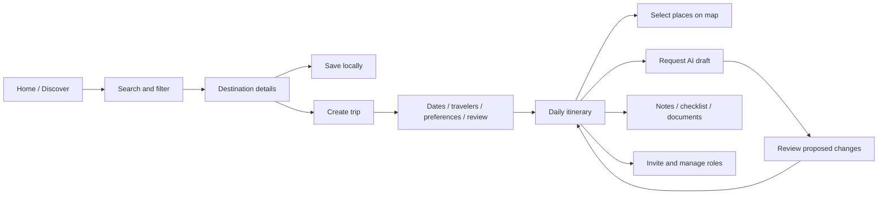

# UX research and product direction

Research date: 4 November 2026. Scope: desk research of accessible official product pages, help articles, and published product images. No interviews, paid accounts, authenticated product walkthroughs, usability sessions, or browser screenshot capture were performed. Marketing claims are identified as claims; accessibility quality and actual mobile performance were not measured. User needs and design scores below are planning hypotheses.

## Reference products and evidence

| Product and official evidence                                                                                                                                                             | Observed/published pattern                                                                                                                                                              | Proposed application and tradeoff                                                                                                                                                |
| ----------------------------------------------------------------------------------------------------------------------------------------------------------------------------------------- | --------------------------------------------------------------------------------------------------------------------------------------------------------------------------------------- | -------------------------------------------------------------------------------------------------------------------------------------------------------------------------------- |
| [Wanderlog](https://wanderlog.com/)                                                                                                                                                       | Its public page explicitly combines itinerary and map and describes discovery, bookings, and shared guides.                                                                             | Keep itinerary and geography in the same workspace. Use progressive disclosure so a wide workspace does not become a dense mobile dashboard.                                     |
| [TripIt](https://www.tripit.com/web)                                                                                                                                                      | Its page describes consolidating confirmation emails into an itinerary and illustrates mobile use; live flight alerts are promoted separately as Pro functionality.                     | Give saved logistics and notes a predictable home. Email ingestion and alerts are outside this project's scope; clear organization is the transferable idea.                     |
| [Roadtrippers mobile guide](https://support.roadtrippers.com/hc/en-us/articles/202594209-Planning-a-Trip-in-Our-Mobile-App)                                                               | Official instructions show map/itinerary switching, editable/rearrangeable stops, dates, and estimated distance/time.                                                                   | Preserve selection when switching list/map on a phone. Only display travel metrics returned by routing; changing a day should reuse loaded data.                                 |
| [Airbnb product release](https://news.airbnb.com/airbnb-2026-summer-release)                                                                                                              | The May 2026 release includes published app images of experiences, service cards, and a hotel detail/room-selection flow.                                                               | Use legible photography cards and a focused details page; keep our planning action explicit. Do not transfer booking or price promises without inventory.                        |
| [Google Travel](https://www.google.com/travel/) and [official Explore article](https://blog.google/products-and-platforms/products/travel/plan-your-summer-travel-with-help-from-google/) | The current page returned an unsupported-browser shell with Explore/Flights/Hotels navigation. The older official article describes budget/trip-length filters and map interest layers. | Search and filters should be easy to discover. The historic article is pattern evidence, not verification of the current interactive UI. No flight-price cards are planned.      |
| [Mindtrip](https://mindtrip.ai/)                                                                                                                                                          | Its public page promotes remembered preferences, contextual suggestions, and building trips around travel style. These are provider claims rather than tested outcomes.                 | Ask a small number of useful preference questions. Keep AI suggestions tied to the active trip and provide a review/apply step; avoid an assistant that silently rewrites plans. |

Roadtrippers' homepage timed out, so the official support guide supplied the evidence. Product pages exposed published image references and some descriptive alternative text; those are not equivalent to inspecting a live product at multiple widths. No claim is made about competitor focus management, empty states, accessibility conformance, or responsiveness where it was not directly observable.

## Synthesis by interaction

| Interaction              | Evidence basis                                                     | Proposed behavior                                                                                     |
| ------------------------ | ------------------------------------------------------------------ | ----------------------------------------------------------------------------------------------------- |
| Landing/discovery        | Airbnb published card flows; Google historical filter descriptions | One destination search, a few meaningful categories, attributed images, clear destination details     |
| Itinerary/day navigation | Wanderlog's combined map/itinerary; Roadtrippers' editing guidance | Date-labeled day rail, ordered activity list, visible add activity, map follows day                   |
| Map/list selection       | Roadtrippers' mobile switching and Wanderlog's combined view       | Shared activity ID; selecting a marker reveals its card; selecting a card highlights its marker       |
| Trip creation            | Roadtrippers' explicit new-trip and stops flow                     | Short wizard, retained entries, clear validation, final confirmation                                  |
| Assistant                | Mindtrip preference claims                                         | Contextual entry from a trip, genuine status/error messages, review before save                       |
| Collaboration            | Wanderlog shared planning positioning                              | Visible roles and invitation state; optimistic UI never overrides server permission checks            |
| Organizer                | TripIt's consolidated itinerary positioning                        | Separate Notes, Checklist, Documents sections within a trip                                           |
| Empty/error states       | No competitor interaction audit available                          | Original design requirement: describe the state and give one useful next action                       |
| Mobile/accessibility     | Roadtrippers documented mode switching; no accessibility audit     | List-first phone workflow, persistent day selection, keyboard equivalent for every map/drag operation |

## User needs: hypotheses to validate

- A traveler with an idea needs to compare destinations without creating an account first.
- A hands-on planner needs dates, places, notes, and daily order in one place, with save status visible.
- A group organizer needs to know who can change the itinerary and whether an invitation was accepted.
- A traveler with limited connectivity needs previously saved local plans and truthful errors when online services fail.
- A reviewer needs a convincing credential-free demonstration that clearly identifies fixture data.

Future lightweight validation tasks: find a destination and save it; create a three-day trip; move an activity to a different position using only the keyboard; find that activity on a phone map; recover from an AI quota message; explain where a trip is stored. Proposed success target: complete each without facilitator guidance; observe errors and confusion before adjusting layouts. No participants or success rates are invented here.

## Three visual directions

Scores are design judgments from 1 (weak) to 5 (strong), not research measurements. Weights reflect a planner's need for clarity and a maintainable implementation.

| Criterion                  | Weight | A: Editorial discovery + focused workspace | B: Dense map-led command center | C: Conversational assistant first |
| -------------------------- | ------ | ------------------------------------------ | ------------------------------- | --------------------------------- |
| Clarity                    | 20%    | 5                                          | 3                               | 3                                 |
| Usability                  | 20%    | 5                                          | 4                               | 3                                 |
| Visual quality             | 15%    | 5                                          | 4                               | 4                                 |
| Accessibility potential    | 15%    | 4                                          | 3                               | 3                                 |
| Originality                | 10%    | 4                                          | 3                               | 4                                 |
| Mobile behavior            | 10%    | 4                                          | 2                               | 5                                 |
| Implementation feasibility | 10%    | 5                                          | 3                               | 3                                 |
| Weighted total / 5         | 100%   | **4.65**                                   | **3.25**                        | **3.45**                          |

**A is selected for proposal.** Warm surfaces and restrained photography suit discovery; a quieter, information-focused workspace supports daily edits. It allows manual planning to feel complete when AI is unavailable. Risk: decorative discovery content can distract from planning; mitigate with a visible My trips entry, one primary action per section, and reduced imagery in the planner.

B prioritizes spatial complexity but makes a 360 px workflow difficult and increases map dependence. C offers a friendly entry point but hides structure inside conversations and weakens the experience without AI quota. Borrow map context and short preference prompts without copying those products' layouts, brand assets, text, or icons.

## Information architecture and journeys

Top-level navigation: Discover, My trips, Saved, Settings; guest workspace is available without login; account controls wait until Phase 10. A trip has Itinerary, Organizer, Members, and later Budget. AI is a contextual action, not the only way to create a trip.

Specific failure journeys:

1. Missing search key: show a Demo destinations banner and search curated data; never label results as provider verified.
2. Cloud unavailable: preserve the current cloud trip and edits in memory, show retry/save status, and avoid falsely claiming persistence. Do not replace it with a sample.
3. AI unavailable: describe the reason and preserve an obvious Add activity action.
4. Invitation requires sign-in: retain a pending invitation reference through a safe same-origin auth return; never expose trip content in the preview.
5. Empty day: show the date, an Add activity action, and contextual discovery suggestions only if the capability is available.
6. Viewer: use read-only activity details with a visible role; do not present edit controls that fail only on save.

## Review plan

Phase 1 validates navigation, tokens, dialogs, focus, and shell layouts. Phase 2 validates discovery and imagery. Revised Phase 3 validates guest trip creation and storage. Phases 4–5 validate the signature planner, including scroll/focus synchronization and no-map alternatives. Phase 7 validates local organizer/backup comprehension. Phase 9 audits complete guest journeys. Final Phase 10 validates account choice, cloud migration and role comprehension. At each relevant phase inspect 360, 768, 1024, and 1440 px widths, 200% zoom, keyboard use, reduced motion, long destination names, empty days, and provider errors. Automated checks supplement manual review and do not establish WCAG conformance alone.

## Guest-first journey clarification — 4 November 2026

Research findings and visual tokens above are preserved. Revised Phase 3 extends editorial discovery into a calm guest dashboard and seven-step wizard (destination, dates, travelers, budget, interests, pace, review). My trips opens local data directly; no login/onboarding gate, invented identity or cloud-sync badge. Local storage and unencrypted JSON backup limits are explicit. Cards show real dates/status/last edit and licensed known-destination imagery or an honest placeholder. Editing returns to the same wizard with retained data; deletion and import have accessible confirmation/preview. Itinerary activities, maps and AI are explanatory future text until their phases. Members, private cloud documents, OAuth and collaboration sketches apply only to final Phase 10. Browser layouts must be reviewed at 360/768/1024/1440 px.

## Phase 6 contextual AI research — 6 November 2026

Public official Mindtrip planning guidance (https://resources.mindtrip.ai/business/dmo-playbook/best-practices) and Wanderlog overview (https://wanderlog.com/) informed trip-aware questions, follow-up suggestions and editable planning rather than a detached general chatbot. Public-page research is not a logged-in competitor audit. Adapt the established editorial studio/dialog, contextual trip summary and draft choices, keeping the manual timeline/map intact. Scope14days/request, explicit sharing notice, selection defaultsnone, exact replacement preview and no automatic saves. Chat history is keyboard-scrollable, reduced-motion progress static, and errors keep manual planning available. No copied proprietary layout or future collaboration/booking workflow.
